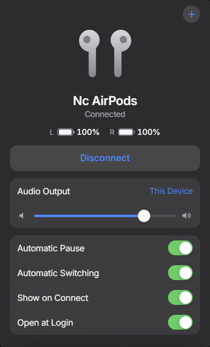

# EarDeck

**A free, lightweight AirPods app for Windows.** See your battery, connect in one click, and pair new AirPods without digging through Windows settings.



## Download and install

It takes about a minute, and you don't need an admin account.

1. **Download** [EarDeck-Setup.exe](https://github.com/diegoarivada/eardeck/releases/latest/download/EarDeck-Setup.exe).
2. **Open** the file you downloaded.
3. If Windows shows **"Windows protected your PC"**, click **More info**, then **Run anyway**. This appears because EarDeck is a free project without a paid code signing certificate. [You can verify the download](#verify-your-download) if you'd like to check it first.
4. **Follow the installer** and click **Finish**.
5. **Look for the EarDeck icon** by your clock. If you don't see it, click the small **^** arrow next to the clock.

You're done. Click the icon any time to open EarDeck.

## Connect your AirPods

**Already paired with this computer?** Click the EarDeck icon, then click **Connect**.

**New AirPods?**

1. Click the EarDeck icon, then the **+** button in the top corner.
2. Click **Connect New AirPods**.
3. Put your AirPods in pairing mode:
   - **AirPods or AirPods Pro:** put them in the case, open the lid, and hold the button on the back until the light flashes white. On models without a button, double-tap the front of the case.
   - **AirPods Max:** hold the noise control button until the light flashes white.
4. Click **Connect** next to your AirPods when they appear.

## What it does

| Feature | What you get |
| --- | --- |
| Battery | Left, right and case for earbuds, or one level for AirPods Max |
| One-click connect | Connect and disconnect from the tray |
| New AirPods | Pair right inside the app |
| My Devices | Switch between more than one pair |
| Automatic Switching | Sends Windows audio to your AirPods when they connect |
| Automatic Pause | Pauses media when you take them out and resumes when you put them back |
| Volume | A slider just for your AirPods |
| Low battery alert | A notification at 20% |
| Open at Login | Starts with Windows if you want it to |

Works with AirPods, AirPods Pro, AirPods Max and several Beats models.

**Changing noise control modes:** press and hold the stem on your AirPods, or use the noise control button on AirPods Max. EarDeck can't switch these from Windows without a kernel driver that would weaken your computer's security, so it leaves that out on purpose.

## What you need

- Windows 10 or 11, 64-bit
- Bluetooth
- AirPods or Beats

The installer sets up Microsoft Edge WebView2 if your computer doesn't have it yet. Most Windows 10 and 11 computers already do.

EarDeck has been tested on Windows 11. Windows 10 should work, but it hasn't been tested yet.

## Light on your computer

Measured on Windows 11 with AirPods connected and the popup closed:

| | |
| --- | --- |
| Memory | about 4 MB private, 22 MB in Task Manager |
| CPU | under 0.3% of one core |
| Installer size | 1.3 MB |

The popup only exists while it's open, so it uses more memory for those few seconds and then gives it all back. While nothing is connected, EarDeck also turns its Bluetooth listening off.

## Having trouble?

| Problem | Try this |
| --- | --- |
| Battery shows "--" | Take your AirPods out of the case, or wear them for a moment. Battery only shows while they're awake and close by. |
| Connect does nothing | Your AirPods may be connected to your phone or asleep in the case. Take them out, turn off Bluetooth on the other device, and try again. |
| New AirPods don't appear | Make sure the light is flashing white, then click **Try Again**. You can also pair in **Bluetooth Settings**, and EarDeck will find them. |
| I can't find the icon | Click the **^** arrow by your clock, then drag EarDeck next to the clock to keep it visible. |

## Uninstall

1. If **Open at Login** is on, turn it off in EarDeck first.
2. Right-click the tray icon and click **Quit**.
3. Go to **Settings > Apps > Installed apps**, find **EarDeck**, and click **Uninstall**.

## Privacy and security

EarDeck has no account, no ads and no tracking, and it never connects to the internet. Your settings stay on your computer.

See [SECURITY.md](SECURITY.md) for how it's protected and how to report a problem.

### Verify your download

Open **PowerShell** in your Downloads folder and run:

```powershell
Get-FileHash .\EarDeck-Setup.exe -Algorithm SHA256
```

The result should match the SHA-256 value listed on the [releases page](https://github.com/diegoarivada/eardeck/releases/latest).

## For developers

You need [Rust](https://rustup.rs) and [Node.js](https://nodejs.org).

```bash
git clone https://github.com/diegoarivada/eardeck.git
cd eardeck
cargo test --bin eardeck
npx @tauri-apps/cli@2 build --bundles nsis
```

| File | What it does |
| --- | --- |
| `src/parser.rs` | Decodes the Bluetooth packets AirPods broadcast |
| `src/ble.rs` | Listens for those packets |
| `src/audio.rs` | Connect, audio output and volume |
| `src/pairing.rs` | Finds and pairs new AirPods |
| `src/media.rs` | Pauses and resumes media |
| `src/monitor.rs` | The background loop that ties it together |
| `src/autostart.rs` | Open at Login |
| `ui/` | The popup |

To build the Bluetooth diagnostic tool, run `cargo build --release --features probe`.

## Thanks

EarDeck builds on public reverse engineering work from [OpenPods](https://github.com/adolfintel/OpenPods), [AirPodsDesktop](https://github.com/SpriteOvO/AirPodsDesktop), [LibrePods](https://github.com/kavishdevar/librepods) and [ToothTray](https://github.com/m2jean/ToothTray). The Inter font is licensed under the SIL Open Font License.

EarDeck is an independent project and isn't affiliated with or endorsed by Apple Inc. AirPods and Beats are trademarks of Apple Inc.

## License

[MIT](LICENSE)
